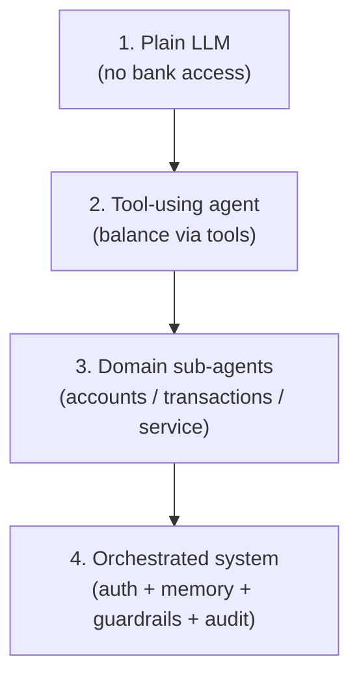
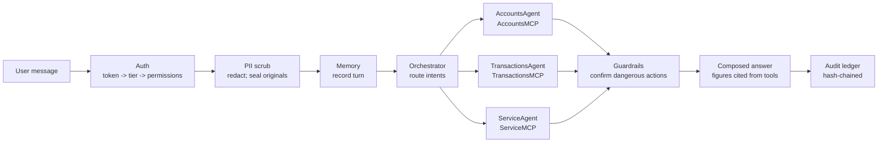
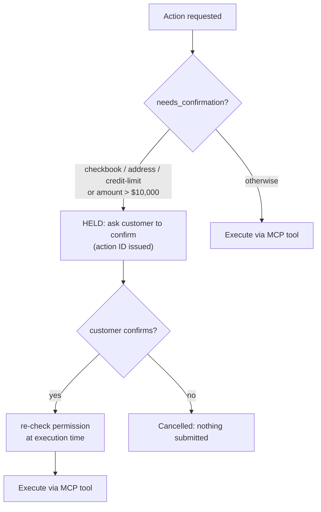
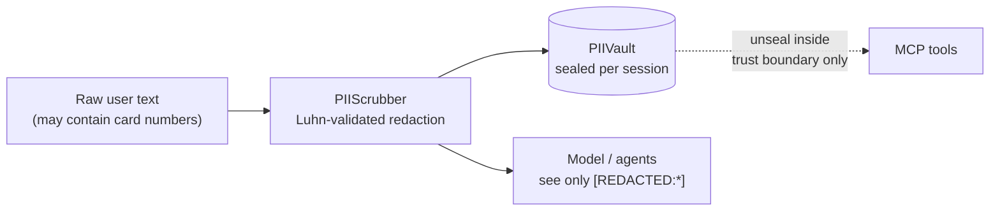

# Architecture

## Layered build-up

Each layer earns its complexity: tools ground answers, sub-agents own
domains, the orchestrator owns safety.

## Request flow

Multi-intent messages ("balance and last 5 transactions") fan out to
multiple sub-agents; their answers are composed into one response.

## Tiered permission matrix

| Tool | Permission | Premium | Standard |
|---|---|---|---|
| list_accounts, get_balance, get_account_info | `accounts.read` | yes | yes |
| list_transactions, get_last_n | `transactions.read` | yes | yes |
| flag_suspicious | `transactions.flag` | yes | yes |
| request_checkbook | `service.checkbook` | yes (confirm) | yes (confirm) |
| update_address | `service.address` | yes (confirm) | yes (confirm) |
| increase_credit_limit | `service.credit_limit` | yes (confirm) | **denied** |

Denials are polite and tier-blind: a standard customer hears "I don't have
permission…", never "premium customers can".

## Confirmation gates

## Trust boundary (PII)

## Audit ledger

Append-only entries: `message.received`, `pii.redacted`, `tool.called`,
`tool.denied`, `guardrail.held`, `guardrail.confirmed`,
`guardrail.executed`, `guardrail.cancelled`, `message.responded`.
Each entry hashes the previous entry's hash; `verify_chain()` detects
any tampering.
